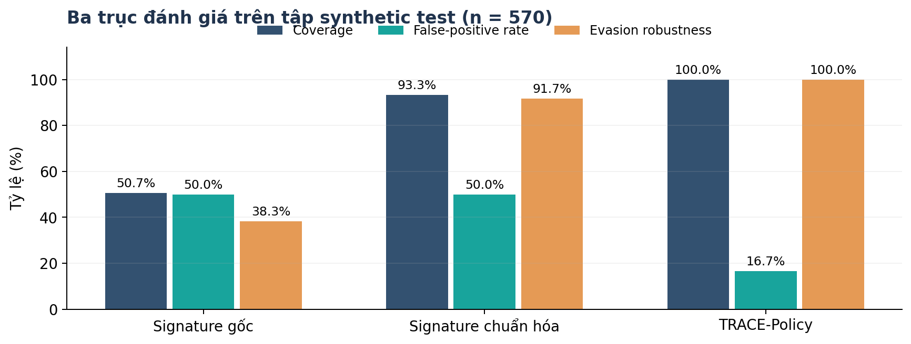
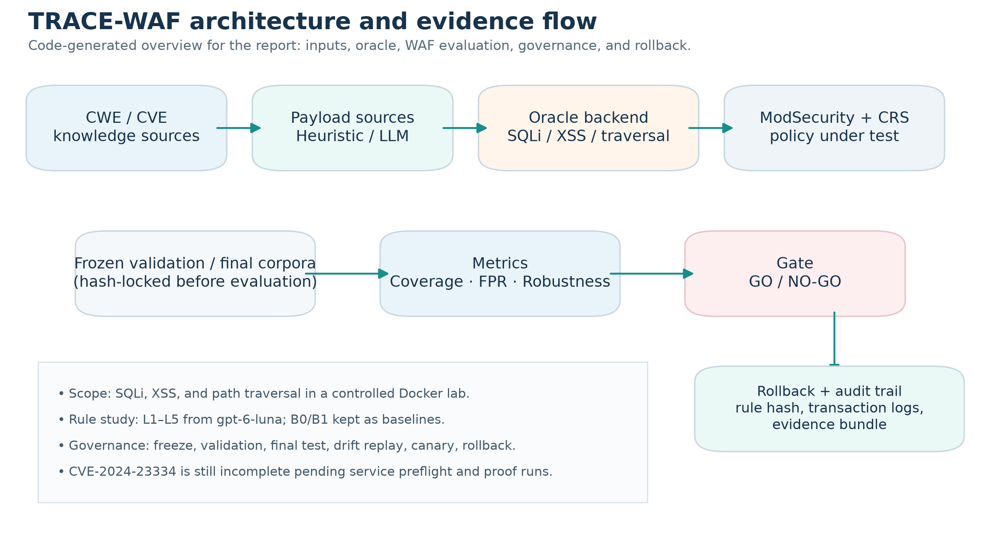

**Đơn vị:** [Đơn vị đào tạo / trường]  
**Email:** [Địa chỉ email]  
**Loại công trình:** Bài báo nghiên cứu thực nghiệm nguyên mẫu; trạng thái checkpoint ngày 17/10/2026.

## Tóm tắt

Nghiên cứu đề xuất TRACE-WAF, một quy trình kết hợp sinh mẫu kiểm thử, đề xuất luật phòng thủ và quản trị thay đổi tường lửa ứng dụng web (WAF) theo ba chỉ số: tỷ lệ chặn tấn công có hiệu lực (coverage), tỷ lệ chặn nhầm lưu lượng hợp lệ (false-positive rate, FPR) và khả năng duy trì phát hiện khi biểu diễn đầu vào biến đổi (evasion robustness). Phạm vi bao gồm SQL injection (CWE-89), cross-site scripting (CWE-79), path traversal (CWE-22), truy vết CWE/CVE, mô hình ngôn ngữ và đối chứng không LLM. Khác với mô phỏng ngoại tuyến ban đầu gồm 570 trường hợp được gắn nhãn theo mẫu, checkpoint mới triển khai backend cố ý có lỗi cùng ModSecurity–OWASP CRS trong phòng thí nghiệm cục bộ, kiểm tra hiệu lực bằng oracle của ứng dụng rồi so sánh bảy cấu hình: CRS gốc (B0), tuning cố định không LLM (B1) và năm ứng viên từ kết quả *gpt-6-luna* đã lưu (L1–L5). Trên validation, mỗi cấu hình chặn 14/14 trường hợp tấn công được xác nhận có hiệu lực; trong 30 mẫu dự định tấn công có 16 mẫu không tạo ra tác động trên backend. FPR của B0 là 5/16 (31,25%); FPR của B1 và L1–L5 là 1/16 (6,25%). Mọi cấu hình còn có một hồi quy phản hồi hợp lệ do proxy thay trang lỗi, nên đều không qua cổng nghiệm thu và quyết định vẫn là **NO-GO**. Test độc lập đã khởi chạy nhưng mới lưu 93/104 quan sát của B0, gồm ba bypass thuộc cùng họ SQLi; chưa thể công bố kết quả test hoàn chỉnh cho bảy cấu hình. Chưa có bằng chứng GPT tốt hơn tuning không LLM, chưa xác minh CVE trên sản phẩm bị ảnh hưởng, và chưa thực hiện replay drift hay vòng tự thích nghi. Đóng góp của bài là phân tầng chứng cứ và quy trình quyết định có thể kiểm toán, đồng thời công bố minh bạch các hạng mục chưa hoàn tất.

**Từ khóa:** TRACE-WAF; ModSecurity; OWASP CRS; SQLi; XSS; path traversal; CWE/CVE; gpt-6-luna; coverage; false positive; robustness; rollback.

## 1. Giới thiệu

### 1.1. Vấn đề nghiên cứu

WAF là lớp phòng vệ đối với các yêu cầu HTTP có dấu hiệu SQL injection, XSS và path traversal, nhưng việc một yêu cầu trả HTTP 403 không tự chứng minh ứng dụng đã được bảo vệ; ngược lại, một yêu cầu HTTP 200 không đồng nghĩa tấn công thành công. Bộ luật OWASP Core Rule Set (CRS) sử dụng các tín hiệu phát hiện và ngưỡng anomaly score, nên điều chỉnh luật luôn tạo ra trao đổi giữa phát hiện và ảnh hưởng tới người dùng hợp lệ [1], [2]. Theo khảo sát do Miggo công bố tháng 12/2025, nhiều trường hợp CVE trong mẫu họ thử có thể vượt cấu hình WAF mặc định; tỷ lệ được công bố là kết quả phụ thuộc tập CVE và điều kiện thử riêng, không phải tỷ lệ tổng quát của thị trường [3]. DEG-WAF và GenSQLi là các hướng liên quan về sinh biến thể và tạo luật có hỗ trợ mô hình [4], [5], nhưng hiệu quả công bố ở các môi trường khác nhau không thể so sánh trực tiếp với nghiên cứu này.

Bài toán quản trị được đặt ra là: làm thế nào tách **tính hợp lệ của khai thác**, **quyết định WAF**, **tác động tới người dùng**, và **bằng chứng cho thay đổi chính sách**, thay vì chỉ tối đa hóa tỷ lệ chặn của một tập chuỗi? Nghiên cứu sử dụng hai cấp thí nghiệm tách biệt: (i) nguyên mẫu kiểm tra chữ ký ngoại tuyến trước đây; (ii) checkpoint với backend có oracle, WAF/CRS thực trong lab cục bộ. Không gộp số liệu hai cấp thành một benchmark duy nhất.

### 1.2. Câu hỏi và đóng góp

Bốn câu hỏi dẫn đường: **RQ1**: mẫu do LLM đề xuất có hiệu lực thực trên backend và có vượt đối chứng sinh mẫu xác định dưới ngân sách tương đương hay không? **RQ2**: luật do LLM đề xuất có cải thiện coverage–FPR–robustness so với CRS gốc và tuning không LLM hay không? **RQ3**: cổng nghiệm thu dựa trên bằng chứng, phân tách lỗi, kiểm toán cấu hình và rollback hoạt động tới đâu? **RQ4**: phạm vi tổng quát tới CVE và khả năng chịu thay đổi cơ cấu lưu lượng đã được chứng minh ở mức nào?

Bài đóng góp một định nghĩa kết quả dựa trên oracle, sơ đồ quyết định change-control, dữ liệu checkpoint có hash và log theo chính sách, phân tích bảy cấu hình ở validation, cùng kiểm kê những kiểm chứng chưa hoàn tất. Đóng góp này mang tính **khung triển khai và báo cáo bằng chứng**, không tuyên bố mới tuyệt đối về ba chỉ số, về kỹ thuật sinh mẫu hay về WAF.

### 1.3. Ranh giới chứng cứ

**Bảng 1. Các mức bằng chứng của nghiên cứu.**

| Cấp | Nội dung có thể khẳng định | Trạng thái |
|:--|:--|:--|
| S0 | Bộ so khớp mô phỏng nhận diện dấu hiệu trên dữ liệu tổng hợp | Đã có kết quả từ thực nghiệm cũ |
| S1 | Oracle xác minh ảnh hưởng của mẫu trên backend lab | Đã có trên dev/validation và phần B0 test |
| S2 | CRS thực chặn hay chuyển tiếp cùng yêu cầu trên lab | Đã có trên validation; test chưa đầy đủ |
| S3 | Một CVE cụ thể trên phiên bản phần mềm có lỗi và bản vá | Chưa có chứng cứ tái lập của dự án |
| S4 | Drift theo thời gian, chính sách tự thích nghi và canary sản xuất | Chưa kiểm chứng |

CWE là danh mục **loại điểm yếu**, còn CVE nhận diện **lỗ hổng cụ thể** gắn với sản phẩm và phiên bản [6]–[8]. Việc một payload CWE-22 đọc được tệp thử trong `lab/backend.py` không được gọi là thực nghiệm trên một CVE.

## 2. Cơ sở liên quan và kiến trúc TRACE-WAF

### 2.1. Nền tảng kỹ thuật và công trình liên quan

OWASP CRS cung cấp tập luật thực tiễn nhưng cần điều chỉnh phù hợp ứng dụng để giảm cảnh báo sai; paranoia level và ngưỡng anomaly không thể thay cho kiểm chứng chức năng [1], [2]. DEG-WAF nghiên cứu sinh mẫu né tránh bằng mô hình và học tăng cường; GenSQLi liên kết sinh payload SQLi với đề xuất phòng thủ [4], [5]. TRACE-WAF kế thừa câu hỏi đánh giá hai chiều nhưng bổ sung yêu cầu oracle và sổ chứng cứ thay đổi. Nghiên cứu **không** thực hiện lại thuật toán DEG-WAF/GenSQLi và **không** coi các kết quả bên ngoài là số đo cơ sở của checkpoint.

### 2.2. Kiến trúc dự kiến và phần đã hiện thực

{width=83%}

Chu trình thiết kế bao gồm: chứng cứ CWE/CVE và ngữ cảnh endpoint → sinh mẫu xác định hoặc đề xuất từ LLM → kiểm tra schema, ngân sách, trùng lặp → oracle backend trực tiếp → qua WAF → tính ba chỉ số và phân rã lỗi → cổng duyệt chính sách → quan sát drift, canary và rollback. Đầu ra mô hình được coi là **dữ liệu không đáng tin**, chỉ được biên dịch từ schema hạn chế; không nhận cấu hình ModSecurity tùy ý do LLM xuất trực tiếp.

Phần đã có trong repository gồm backend lab, runner quan sát, trình biên dịch các đề xuất luật có whitelist tuyến và kích thước regex, cơ chế freeze bằng SHA-256, kiểm tra cú pháp Apache, khởi động lại WAF cho từng ứng viên, nhãn `X-Trace-Policy`, log backend/CRS và rollback. Phần chưa có bằng chứng là kiểm chứng CVE thật, tự cập nhật theo drift, kiểm định trên lưu lượng sản xuất và phê duyệt độc lập nhiều vai trò.

### 2.3. Đối chứng và cấu hình có kiểm soát

Backend lab chạy từ image `python:3.12-slim`; WAF dùng `owasp/modsecurity-crs:apache` và log validation ghi CRS **4.30.0**. Hai endpoint chỉ bind vào loopback (`127.0.0.1:18080` cho backend, `127.0.0.1:18081` cho WAF), dữ liệu oracle được đánh dấu tổng hợp. CRS dùng blocking paranoia 1, inbound anomaly threshold 5 và outbound threshold 100. Kiểu cấu hình này là bản chụp của lab, không chứng minh mọi lần chạy dùng chính xác image digest khi pull lại tag chưa cố định; manifest còn ghi digest quan sát tại thời điểm chạy.

Bảy ứng viên đã được tạo **trước khi** khảo sát validation: B0 là CRS mặc định của lab, B1 là tuning định trước không LLM; L1–L5 là năm cấu hình được biên dịch từ kết quả `gpt-6-luna` lưu từ lượt trước. Một lần sửa bộ biên dịch biểu diễn dấu ngoặc kép được kiểm thử cú pháp rồi **replay phản hồi đã lưu**, không có năm lần sinh mới độc lập. Trên nhánh LLM chỉ dùng alias `gpt-6-luna` cho nghiên cứu chính; các record thử kết nối model khác nếu tồn tại ở lịch sử repository không được đưa vào so sánh và không bị xóa khỏi hồ sơ.

## 3. Phương pháp, dữ liệu và định nghĩa phép đo

### 3.1. Phân tách các bộ dữ liệu

Nghiên cứu không thay thế mô phỏng cũ bằng lab mới. **Mô phỏng S0** gồm 570 trường hợp kiểm thử (450 chuỗi gắn dấu hiệu tấn công và 120 mẫu hợp lệ), so sánh ba bộ phân loại do người viết xây dựng. Tại cấp này, “tấn công” là **nhãn theo nguồn sinh**, chưa có oracle thực thi; 570 hàng không phải 570 khai thác CVE độc lập.

**Corpus checkpoint** `results/checkpoint/corpus.json` gồm 196 hàng nền, chia dev 46, validation 46 và test 104 hàng. Dev bổ sung 24 mẫu ứng viên GPT vượt kiểm tra đầu vào để có 70 quan sát trong lần baseline dev. Validation gồm 30 ứng viên dự định tấn công theo heuristic và 16 trường hợp benign; test đã khóa gồm 60 ứng viên tấn công heuristic và 44 benign. Dữ liệu có 6 cặp đầu vào giống hệt xuất hiện ở các split khác nhau; việc gán tên family khác nhau không đủ chứng minh độc lập ngữ nghĩa. Trong test, audit còn báo 4 trùng lặp nội nguồn; không được xem số lượng hàng là số họ khai thác độc lập.

**Bảng 2. Quy mô các tập checkpoint; không nhầm mẫu dự định tấn công với mẫu có hiệu lực.**

| Tập | Tấn công heuristic dự định | Mẫu GPT được nhận | Benign | Tổng |
|:--|--:|--:|--:|--:|
| Dev được quan sát | 30 | 24 | 16 | 70 |
| Validation | 30 | 0 | 16 | 46 |
| Test đã khóa | 60 | 0 | 44 | 104 |

Mỗi CWE có các biến thể raw, URL-encoded, double-encoded và biến đổi riêng (ví dụ khoảng trắng/comment, case/HTML entity, các thành phần path). Những biến thể khác hình thức nhưng chung nguồn không được xem là phép thử thống kê độc lập. Nhãn CWE gắn theo **ngữ cảnh tuyến kiểm thử**; một benign chứa ký tự giống XSS trong `/search` vẫn được phân nhóm theo tuyến khi thống kê, không phải bằng chứng nó là một trường hợp SQLi.

### 3.2. Oracle hiệu lực, xác nhận WAF và phân lớp lỗi

Với mỗi case, runner gửi yêu cầu trực tiếp tới backend và qua WAF trong lab. Tác động trên `/sql` đòi hỏi xuất hiện marker dữ liệu ẩn trong kết quả SQL; trên `/xss` dùng trình duyệt theo cửa sổ quan sát hữu hạn để xem sự kiện đánh dấu; trên `/file` cần đọc được chuỗi canary ở ngoài thư mục public nhưng **bên trong fixture bị giới hạn**. Nếu một mẫu dự định tấn công không tạo hiệu lực ở đường trực tiếp, nó được phân loại `invalid_attack`, không nằm trong mẫu số coverage/bypass. Một phản hồi 403 chỉ được xem là WAF chặn nếu thiếu dấu echo `X-Trace-Request` của backend; log CRS có thể củng cố kết luận. Lỗi 5xx, exception, không xác nhận được tác động hoặc thiếu phản hồi là `uncertain`, không được biến thành block thành công.

Ở phía benign, đáp ứng kỳ vọng phải trùng status và body chuẩn hóa so với backend. `false_positive` là trường hợp WAF chặn một yêu cầu benign; `benign_regression` là trường hợp yêu cầu không bị WAF chặn nhưng nội dung/status bị biến đổi. Hai loại lỗi **không hoán đổi**. Trên validation có phản hồi backend 404 `not found` nhưng proxy thay thành trang HTML `404 Not Found` vì `PROXY_ERROR_OVERRIDE=on`; đây là hồi quy chức năng, không phải một `false_positive` do WAF chặn và cũng không phải lỗi kết nối.

### 3.3. Ba trục và quy tắc phê duyệt

Gọi $A_v$ là các mẫu tấn công có tác động được oracle xác nhận trên backend trực tiếp và có kết quả WAF xác định; $A_t\subseteq A_v$ là các biến thể được gắn nhãn *transformed*; $B$ là các benign có kết quả xác định. Tính:

$$
\mathrm{Coverage}=\frac{N_{\mathrm{blocked,valid}}}{N_{\mathrm{valid\ attack}}}.
$$

$$
\mathrm{FPR}=\frac{N_{\mathrm{false\ positive}}}{N_{\mathrm{evaluable\ benign}}}.
$$

$$
\mathrm{Robustness}=\frac{N_{\mathrm{blocked,transformed}}}{N_{\mathrm{valid\ transformed}}}.
$$

Trong mã checkpoint, benign regression vẫn nằm trong mẫu số FPR nhưng được kiểm tra bởi một **cổng chất lượng độc lập**. Giá trị null cần được giữ khi không có mẫu phù hợp. Các giá trị 100% robustness trên ít mẫu có hiệu lực không chứng minh WAF bất khả vượt qua; mọi biến thể không có tác động đã bị loại khỏi mẫu số.

Ngưỡng thí nghiệm đã xác lập trước validation: coverage $\geq 90\%$, FPR $\leq 5\%$, robustness $\geq 85\%$, có mẫu hợp lệ và benign ở cả ba CWE, không có quan sát không chắc chắn, và **không có benign functional regression**. Ngưỡng 5% là giả định nội bộ cho nghiên cứu, không phải chuẩn công nghiệp hoặc giấy phép deploy. Chính sách chỉ đủ điều kiện test tiếp nếu đi qua toàn bộ cổng; ngay cả sau đó test độc lập cũng không tự tạo phê duyệt production.

### 3.4. Khóa ứng viên, kiểm toán và vòng đời test

`results/checkpoint/rule-study/20261016T170642475819Z/frozen-plan.json` liệt kê B0, B1, L1–L5 và SHA-256 của từng file `.conf`, đồng thời ghi SHA corpus, compiler, chứng cứ dev và nguồn replay. SHA-256 của *toàn bộ file kế hoạch* trong `frozen-plan.sha256` là `80897b18898c5e90285e47de12f5de3acd4f14cf620cf802380537a2f592f5a3`. `results/checkpoint/final-test/test-protocol.json` kế thừa danh sách băm, quy định `api_calls=0`, `selection_allowed=false` và NO-GO từ validation. Mọi thay đổi ứng viên theo quan sát test sẽ làm hỏng tính tiền đăng ký của đánh giá; nghiên cứu này **không đề xuất chỉnh/tuning lại** L1–L5 hoặc B1 để tối ưu kết quả.

## 4. Kết quả mô phỏng ngoại tuyến trước checkpoint (S0)

**Bảng 3. Kết quả S0 trên 570 trường hợp tổng hợp, không phải số đo lab WAF.**

| Bộ nhận diện mô phỏng | Coverage mẫu gắn nhãn | FPR mẫu benign | Robustness biến thể |
|:--|--:|--:|--:|
| Raw signature | 50,67% | 50,00% | 38,33% |
| Canonical signature | 93,33% | 50,00% | 91,67% |
| TRACE-Policy mô phỏng | 100,00% | 16,67% | 100,00% |

{width=79%}

S0 mô tả cơ chế chuẩn hóa/áp ngữ cảnh giúp tăng độ nhạy trên các mẫu do cùng tác giả xây dựng. Nó không có bước kiểm chứng khai thác trên backend thật, không chạy WAF thương mại hoặc LLM, và FPR chịu ảnh hưởng bởi tập hard-negative tổng hợp. Do đó con số 100% trong S0 và các con số ở checkpoint không so sánh trực tiếp như cùng một benchmark. Trạng thái S0 được giữ để bảo toàn lịch sử nghiên cứu, không được trình bày thành chứng cứ hoàn thành nghiên cứu CVE.

## 5. Checkpoint thực nghiệm ModSecurity–CRS (S1–S2)

### 5.1. Sinh mẫu GPT có oracle ở dev

Năm record đề xuất payload với alias `gpt-6-luna` được lưu từ đợt trước, mỗi lượt được yêu cầu tối đa 12 ứng viên. Audit cho thấy **2/5** phản hồi có danh sách đúng 12 ứng viên theo schema và **3/5** trả cấu trúc không đáp ứng ngân sách yêu cầu; không có gọi lại để “sửa” kết quả. Hai lượt hợp lệ cung cấp **24** case được nhận vào dev, trong đó chỉ **3/24** tạo tác động backend (đều ở nhóm XSS) và đều bị CRS chặn; **21/24** không có tác động được xác nhận. Với đối chứng heuristic trên dev, **14/30** trường hợp có tác động và bị chặn; đây không phải so sánh đồng ngân sách hoặc độc lập họ mẫu tuyệt đối. Các record GPT đã lưu trong `results/checkpoint/llm/payload-gpt-6-luna-*.json` được giữ nguyên.

Các dữ kiện này không chứng minh GPT sinh mẫu tốt hơn heuristic: số lượt hợp lệ thấp, định dạng câu trả lời thất bại ba lần, phụ thuộc vào seed dev, ngân sách mẫu khác nhau, và tỷ lệ mẫu thực sự có hiệu lực thấp. Chỉ dựa vào tỷ lệ chặn 100% **trong ba mẫu GPT có hiệu lực** sẽ gây hiểu lầm vì đã bỏ qua 21 mẫu không có hiệu lực; số bypass được xác minh của nhóm GPT ở dev là 0 trong 3 mẫu hợp lệ, không phải “không thể bypass CRS”.

### 5.2. Kết quả validation của bảy chính sách

Validation của lượt `20261016T170642475819Z` đã hoàn tất cho cả bảy phương án, tổng cộng 46 case/phương án: 14 tấn công có hiệu lực, 16 tấn công không có hiệu lực, 16 benign. Không có observation `uncertain` được ghi trong summary; tất cả ứng viên đều qua syntax và activation. Bảng 4 đối chiếu đúng mẫu số dựa trên oracle.

**Bảng 4. Kết quả validation cố định trên 46 case cho từng policy.**

| Chính sách | Chặn / attack hợp lệ | FP / benign | FPR | Benign regression | Gate |
|:--|:--:|:--:|--:|:--:|:--:|
| B0 — CRS gốc | 14/14 | 5/16 | 31,25% | 1 | NO-GO |
| B1 — heuristic cố định | 14/14 | 1/16 | 6,25% | 1 | NO-GO |
| L1 — gpt-6-luna | 14/14 | 1/16 | 6,25% | 1 | NO-GO |
| L2 — gpt-6-luna | 14/14 | 1/16 | 6,25% | 1 | NO-GO |
| L3 — gpt-6-luna | 14/14 | 1/16 | 6,25% | 1 | NO-GO |
| L4 — gpt-6-luna | 14/14 | 1/16 | 6,25% | 1 | NO-GO |
| L5 — gpt-6-luna | 14/14 | 1/16 | 6,25% | 1 | NO-GO |

Coverage và robustness ghi nhận của cả bảy là 100% **trên những mẫu có tác động được xác nhận của validation**, không phải 100% trên 30 mẫu định hướng tấn công và không phải một kết luận về tập test. B1 cải thiện FPR so với B0 trên tập nhỏ này; L1–L5 **không cải thiện hơn B1 ở bất kỳ chỉ số nào của cổng phê duyệt**. Số lượt L1–L5 cũng không tương ứng năm mẫu sinh độc lập ở giai đoạn replay compiler, vì chúng dùng lại năm phản hồi lưu trước đó. Không có ứng viên đạt FPR $\leq 5\%$ hoặc loại bỏ được hồi quy 404.

### 5.3. Phân rã theo CWE và nhóm lỗi

**Bảng 5. Phân rã theo CWE tại validation; phân nhóm benign dựa vào tuyến kiểm thử.**

| Nhóm gán theo tuyến | Attack hợp lệ bị chặn (mọi cấu hình) | B0: FP / benign | B1, L1–L5: FP / benign |
|:--|:--:|:--:|:--:|
| CWE-89 / SQLi | 6/6 | 2/6 | 0/6 |
| CWE-79 / XSS | 4/4 | 2/6 | 0/6 |
| CWE-22 / traversal | 4/4 | 1/4 | 1/4 |

Trong 30 ý định tấn công, có **16 invalid_attack** gồm 4 SQLi, 6 XSS và 6 traversal. Chúng không tạo tác động khi đi thẳng vào backend theo oracle và do đó không thể là bằng chứng WAF chống được khai thác. Đối với benign, B0 có 5 false positive: hai trên `/search`, hai trên `/docs` và một trên `/file`. B1 cùng L1–L5 loại bỏ được bốn lần chặn nhầm tại các tuyến mà giá trị `q` được HTML-escape, nhưng vẫn chặn `validation-benign-file-2` (đọc `../public/readme.txt` hợp lệ trong fixture) với status 403, trong khi trực tiếp backend trả `PUBLIC_DOCUMENT` và status 200. Đây là ví dụ cụ thể về rule quá rộng trên ngữ nghĩa path.

Một trường hợp khác `validation-benign-file-3` yêu cầu tệp không tồn tại: backend trả `404` với body `not found`, còn qua proxy cũng trả `404` nhưng là trang HTML lỗi của Apache. Do thiếu tương đương body với backend, runner phân loại `benign_regression=1` cho **mọi** ứng viên, không tự gán thành FPR. Dấu `PROXY_ERROR_OVERRIDE=on` trong manifest là một giải thích kỹ thuật phù hợp, song để khẳng định nguồn gây biến đổi có tính nhân quả hoàn toàn vẫn nên kiểm chứng A/B proxy có kiểm soát ở vòng nghiên cứu khác, không chỉnh cấu hình trong lượt khóa hiện tại.

### 5.4. Đối chiếu log, rollback và lỗi hạ tầng

Các `*-validation/observations.jsonl` ghi request ID, hiệu lực trực tiếp, status WAF, dấu echo backend và nhãn kết quả; `backend-logs.json` chứa yêu cầu mà backend thực nhận; `waf-logs.json` ghi cảnh báo CRS, ngưỡng và quyết định chặn. Ví dụ log WAF có `942100` cho phát hiện SQLi, `949110` cho inbound anomaly score vượt ngưỡng và HTTP 403. Phải đối chiếu theo request/transaction, không gắn một quy tắc CRS vào một case chỉ vì trùng thời gian hoặc cùng status. Trong validation, các summary đánh dấu `complete=true`, `uncertain_rows=0`; không có bằng chứng cho lỗi 5xx của các case được tính. `rollback.json` xác nhận `attempted=true`, `restored=true`, với hash file gốc `98b3b9c70039268487d31bb2caff2b08a63e2da0c0bf1a2144e233d804317df8` sau toàn bộ lượt validation.

Rollback trên đây chỉ được kiểm chứng **sau validation**. Không thể mặc nhiên khẳng định WAF đã được khôi phục sau tiến trình final test bị gián đoạn: repository hiện thiếu bản ghi `final-test/rollback.json`. Do đó trạng thái vận hành của host gốc phải được kiểm tra độc lập trước mọi can thiệp mới. Nếu mất đồng bộ log hoặc không truy vết được transaction, phải báo `uncertain`, không coi như “đã chặn”.

### 5.5. Final test đã khóa nhưng bị ngắt: phân biệt chứng cứ và hạng mục dở dang

Tệp `results/checkpoint/final-test/test-protocol.json` có `api_calls=0`, `selection_allowed=false`, liệt kê đủ B0, B1, L1–L5 với rule hash đúng frozen-plan. Dữ liệu cho thấy cú pháp và kích hoạt B0 thành công (`B0-syntax.json`, `B0-activate.json`), đã tạo corpus test 104 case và lưu **93 quan sát** trong `B0-test/observations.jsonl`. Repository **chưa có** summary B0 test, bản ghi đủ 104 quan sát, log WAF/backend cuối của test, dữ liệu test B1–L5, hoặc rollback của final test. Vì vậy checkpoint test **chưa nghiệm thu hoàn thành**, không được đặt cột kết quả cuối cùng cho tất cả bảy chính sách.

Trong **93 quan sát B0 đã lưu**, số đếm theo nhãn là 25 `blocked_attack`, 3 `bypass`, 32 `invalid_attack`, 23 `true_negative` và 10 `false_positive`. Ba bypass cùng thuộc họ SQLi `test-sql-0` ở ba biến thể raw, comments và tab; trên đường trực tiếp **và qua WAF** đều trả status 200 và có dấu hiệu đọc marker `TRACE_SQL_SECRET`. Đây là bằng chứng sơ bộ quan trọng rằng B0 có thể bị vượt qua trên một họ mẫu của test trong lab; không phải ba lỗ hổng độc lập, không phải CVE, và không chứng minh kết quả của B1 hay L1–L5. Cả 60 case tấn công theo thứ tự test có bản ghi trong 93 hàng, nhưng 11 benign cuối còn thiếu; tỷ lệ FPR/test và cổng nghiệm thu không được công bố khi phép đo bị ngắt.

**Không chạy lại `lab/run_final_test.py` như một phép thử mới** để che mất gián đoạn: script hiện hành tạo thư mục output với `exist_ok=False`, và test đã được nhìn thấy một phần. Phương án có tính toàn vẹn là bảo toàn 93 hàng cùng toàn bộ hash, xác minh host/rollback, chỉ khôi phục các quan sát chưa có nếu có một cơ chế resume append-only được kiểm chứng trước, giữ nguyên rule và thứ tự, đồng thời công khai sự cố. Nếu không thể xác minh khả năng resume, phải đánh dấu test thiếu thay vì chạy lại và lựa chọn chính sách theo các kết quả đã nhìn thấy. Không dùng chính các bypass B0 để sửa luật của bất kỳ ứng viên nào trong vòng đánh giá này.

## 6. Phân tích chuyển dịch cơ cấu dữ liệu và drift

Báo cáo S0 trước đây gọi một bảng tách nhóm là “synthetic drift”: với 180 mẫu biểu diễn đơn giản (nhóm A), các tỷ lệ phát hiện raw/canonical/TRACE đều 100%; với 270 mẫu có biến đổi biểu diễn (nhóm B), ba tỷ lệ lần lượt là 17,78% / 88,89% / 100%. Cách gọi chính xác là **phân tích tĩnh theo nhóm và chuyển dịch cơ cấu mẫu**, không phải temporal replay. Không có luồng thời gian, không có WAF chạy lại theo một chuỗi phân bố mới, không có vòng tự sửa rule được đo.

{width=78%}

Ở checkpoint ModSecurity, validation có 30 mẫu heuristic/16 benign, test khóa có 60 mẫu heuristic/44 benign; tỷ trọng benign tăng từ 34,8% lên 42,3% do **thiết kế corpus**, không chứng minh sự thay đổi phân bố của một hệ thống vận hành. Hai tập còn chia sẻ sáu đầu vào trùng khớp ở mức corpus toàn bộ. Kết quả subgroup hoặc thay đổi mẫu số có thể được dùng để **đề xuất cảnh báo drift**, nhưng không đủ gọi là replay có kiểm soát. Phép kiểm định sau này cần giữ chính sách bất biến, phát lại các đợt traffic có dấu thời gian/nguồn, so sánh accuracy và FPR theo nhóm, rồi mới kiểm nghiệm từng bước *observe → diagnose → propose → review → validate → canary → rollback*. Không tuyên bố TRACE-WAF đã chứng minh khả năng tự thích nghi.

## 7. Nghiên cứu tình huống CVE-2024-23334: phương án tái lập, chưa kiểm chứng

Để nối từ CWE-22 đến một sản phẩm có CVE thực, nghiên cứu chọn **CVE-2024-23334**, path traversal trong `aiohttp` khi ứng dụng cấu hình phục vụ static với `follow_symlinks=True`. Advisory xác định các phiên bản từ `1.0.5` đến trước `3.9.2` bị ảnh hưởng; phiên bản `3.9.2` chứa bản sửa [10], [11]. Điều kiện kích hoạt này là đặc trưng của *sản phẩm và cấu hình*; **không** đồng nhất với endpoint `/file` của backend Python tự viết. Thực nghiệm tại repository hiện không chứa phiên bản `aiohttp` bị ảnh hưởng và không có log chứng minh khai thác CVE qua CRS.

Giao thức tình huống đề xuất là dựng hai container cô lập có cùng nội dung tệp canary giả ngoài static root nhưng trong không gian container: phiên bản bị ảnh hưởng `aiohttp==3.9.1` và bản vá `aiohttp==3.9.2`; ứng dụng dùng đúng đường `web.static(..., follow_symlinks=True)`. Với mỗi phiên bản, đo đồng thời direct backend và qua cùng WAF/CRS đã cố định; dùng request giữ nguyên đường dẫn và các biến thể mã hóa, ghi status, body hash, marker canary, WAF transaction ID, server version, image digest và response origin. Phép đối chứng bản vá phải chứng minh cùng truy vấn không đọc canary sau vá. Ma trận bốn ô là (phiên bản có lỗi, direct), (có lỗi, qua WAF), (đã vá, direct), (đã vá, qua WAF). Không dự đoán ô nào thành công dựa trên URI đơn thuần.

**Trạng thái thực hiện tại thời điểm khóa báo cáo: CHƯA HOÀN THÀNH.** Nguồn công khai xác nhận mô tả CVE và ranh giới phiên bản, không thay thế được việc chạy trong lab do nghiên cứu quản lý. Không có kết quả `HTTP status`, canary hoặc WAF trace của ma trận trên trong repository. Vì vậy không tính một CVE là đã “được bảo vệ” hay “bypass được WAF”; trường này chỉ là nghiên cứu tình huống được chuẩn bị về thiết kế. Kể cả khi tái lập thành công, một CVE path traversal duy nhất cũng không đại diện mọi CVE hay ba nhóm CWE.

## 8. Chính sách, kiểm toán và quyết định quản trị

Một rule có thể có coverage cao mà vẫn gây hại do chặn tài liệu hợp lệ, lỗi trang, phản hồi proxy thay đổi, hoặc phạm vi áp dụng quá rộng. Cổng phê duyệt cần lưu `rule_id`, CWE, `cve_id` **chỉ khi đã tái lập**, phiên bản ứng dụng/CRS, hash của policy và corpus, nguồn ứng viên (heuristic hay `gpt-6-luna`), dữ liệu oracle, người chịu trách nhiệm, hạn xem xét, kế hoạch thu hồi và log phê duyệt. Các trường trong `rules/rule_register.json` ban đầu ở cấp CWE là sổ luật nguyên mẫu, chưa biến thành kết quả xác minh CVE.

**Bảng 6. Điểm kiểm soát thay đổi và trách nhiệm minh họa.**

| Điểm kiểm soát | Bằng chứng bắt buộc | Trách nhiệm minh họa |
|:--|:--|:--|
| Truy vết nguồn | CWE, CVE nếu xác thực, phiên bản, provenance, checksum | AppSec / nghiên cứu |
| An toàn đề xuất LLM | Alias, prompt version, raw response, schema, compiler, giới hạn route/rule | AI governance / AppSec |
| Oracle và phản hồi | Direct effect, WAF effect, backend echo, WAF transaction | Người đo kiểm |
| Tác động người dùng | FPR, benign regression, phân rã theo endpoint/CWE, canary | Application owner / SRE |
| Quản lý thay đổi | Bản kế hoạch đóng băng, ký duyệt, rollout, rollback test và hậu sự cố | Change manager |

Chỉ sử dụng nội dung request và log tổng hợp của lab; với dữ liệu thật cần xóa hoặc che PII/token, kiểm soát quyền và không đưa log không tin cậy vào prompt với quyền cập nhật rule. LLM là tác nhân **đề xuất** chứ không có quyền tự disable CRS hoặc publish vào production. Chỉ số báo cáo phải có mẫu số, sự kiện ngoại lệ và tình trạng completeness; không tự hợp thức hóa một ứng viên sau khi quan sát test.

Quyết định của checkpoint: **NO-GO đối với triển khai và không có ứng viên được chọn**. Điều này không phủ nhận thử nghiệm đã chạy ở validation; nó tách “kiểm chứng cơ chế pipeline” khỏi “đủ chứng cứ vận hành” và “được cấp quyền deploy”. Sự cố test bị ngắt và chưa xác minh rollback sau test còn là một điểm chặn riêng về quản trị thay đổi.

## 9. Bảng nghiệm thu checkpoint, hạn chế và nghiên cứu tiếp theo

### 9.1. Nghiệm thu theo chứng cứ

**Bảng 7. Nghiệm thu checkpoint theo mức độ hoàn chỉnh của chứng cứ.**

| Hạng mục | Bằng chứng hiện có | Kết luận nghiệm thu |
|:--|:--|:--|
| Giữ SQLi, XSS và path traversal | Corpus, oracle ba tuyến CWE-89/79/22 | ĐẠT trong lab giới hạn |
| Giữ kết quả S0 không sửa | `results/`, 570 mẫu mô phỏng | ĐẠT, tách khỏi checkpoint |
| LLM sinh mẫu có đối chứng | 5 record GPT; 2 lượt đúng schema; 24 dev case; heuristic control | MỘT PHẦN, chưa đồng ngân sách/độc lập |
| LLM đề xuất luật; B0/B1/L1–L5 | 7 policy đóng băng, validation complete | ĐẠT ở validation |
| Phân rã CWE/false positive/lỗi proxy | 7 summary, observation, log | ĐẠT ở validation |
| Cổng ba trục và quyết định | Gate minh họa, cả 7 NO-GO | ĐẠT về áp dụng chính sách |
| Rollback validation | `rollback.json` và hash nguồn | ĐẠT ở validation |
| Khóa test không chọn lại | `frozen-plan`, `test-protocol` | ĐẠT về kế hoạch |
| Test một lần cả 7 phương án | 93/104 observation B0; B1–L5 chưa có | CHƯA ĐẠT |
| Rollback sau final test | Chưa có tệp rollback final | CHƯA XÁC MINH |
| CVE gắn sản phẩm/phiên bản | Phân tích advisory aiohttp; không có lab trace | CHƯA ĐẠT |
| Drift replay và adaptive loop | Chỉ tách nhóm tĩnh / so cơ cấu corpus | CHƯA ĐẠT |
| Phê duyệt production độc lập | Chưa có canary và owner phê duyệt | KHÔNG ÁP DỤNG; NO-GO |

### 9.2. Đe dọa đối với tính hợp lệ

**Cấu trúc phép đo.** Oracle SQL chỉ kiểm tra marker, oracle XSS phụ thuộc trình duyệt và cửa sổ thời gian quan sát, oracle traversal giới hạn fixture; không bao phủ mọi hành vi khai thác. Mẫu invalid không thể được xem là mẫu bypass thất bại. Số lượng bên trong mỗi CWE còn rất nhỏ (validation lần lượt 6, 4 và 4 tấn công có hiệu lực), nên điểm phần trăm dễ dao động. “Robustness 100%” là tỷ lệ có điều kiện trên những biến thể có hiệu lực, không phải phủ mọi không gian biến đổi.

**Nội tại và thống kê.** Các case có quan hệ template với nhau, corpus audit phát hiện sáu đầu vào trùng giữa split và bốn trùng trong test; chưa có tách độc lập theo ứng dụng/CVE. Năm cấu hình GPT không phải năm model độc lập; replay compiler không phải sinh lại mô hình. Ngân sách sinh mẫu không cân bằng: 24 ứng viên GPT được chấp nhận vs 30 biến thể heuristic ở dev, chỉ hai lượt GPT tuân thủ schema, và chưa có so sánh ngang chi phí/độ trễ. Không áp dụng kiểm định ý nghĩa thống kê đối với các biến thể phụ thuộc.

**Bên ngoài và vận hành.** Lab chạy các fixture có chủ đích, dùng CRS với tag image quan sát tại một thời điểm; không có lưu lượng người dùng, phân bố base-rate ngoài đời, tuyến nghiệp vụ, CVE tái lập hoặc vòng canary. Ghi nhận 404 proxy thay trang lỗi phụ thuộc cấu hình host; không được quy toàn bộ lỗi 404 cho WAF rule. Hơn nữa lượt test bị gián đoạn, chưa có 7 bộ kết quả cuối cùng và chưa có xác minh rollback cuối.

### 9.3. Công việc mở, không viết lại lịch sử

Để tiếp tục có trách nhiệm, trước hết đóng băng bản sao bất biến của `final-test`, đối chiếu 93 observation B0 với manifest/case ID và xác định 11 case thiếu, bảo toàn hash và tất cả bằng chứng; kiểm tra cấu hình `active-rules.conf`, policy header và khôi phục baseline trên host gốc với log công khai. Chỉ cho phép khôi phục phần thiếu bằng một runner append-only được chứng minh không gửi lại các case đã hoàn tất; nếu không bảo đảm tính một lần, công bố thí nghiệm bị ngắt, không thay các hàng quan sát bằng kết quả mới. Sau đó cần thực hiện tình huống CVE cô lập, lưu body canary và bản vá; kiểm tra replay theo phân bố định trước; và thiết kế vòng review của người có thẩm quyền. Các pha sau phải có pre-registration và tập độc lập, không sử dụng test hiện đã xem để tối ưu luật.

## 10. Kết luận

Checkpoint TRACE-WAF đã chuyển được một phần đề tài từ mô phỏng dấu hiệu sang đo hành vi trên backend có oracle và ModSecurity–OWASP CRS trong lab, đồng thời thực thi được quản lý bằng chứng, validation bảy chính sách và rollback. Ở validation, tuning heuristic không LLM và năm cấu hình từ `gpt-6-luna` có **cùng** coverage, robustness, FPR và cùng hồi quy benign; không có chứng cứ mô hình vượt đối chứng. Cả bảy bị loại bởi FPR và hồi quy chức năng. Test cuối hiện bị gián đoạn: trong 93 hàng B0 có ba bypass cùng họ SQLi nhưng chưa thể xác nhận kết quả bảy phương án. CVE-2024-23334 là đề xuất nghiên cứu tình huống, **chưa** được tái lập bởi nghiên cứu; drift hiện chỉ là phân tích cơ cấu, **chưa** có replay/tự thích nghi. Kết luận khoa học thích hợp là **NO-GO và nghiệm thu theo cấp chứng cứ**, không phải tuyên bố hoàn thành đầy đủ đề tài hay khả năng triển khai production.

## Tài liệu tham khảo

[1] OWASP Foundation. *OWASP Core Rule Set (CRS).* <https://owasp.org/projects/crs/> (truy cập 17/10/2026).

[2] OWASP CRS Project. *CRS Documentation: Anomaly Scoring, Paranoia Levels, False Positives and Tuning.* <https://coreruleset.org/docs/index.print> (truy cập 17/10/2026).

[3] Miggo Security. *Beat the Bypass: A Benchmark Study of WAF Weaknesses and AI Mitigation*, 17/12/2025. <https://www.miggo.io/reports-webinar/benchmark-study-of-waf-weakness-and-ai-mitigation>.

[4] T. G. Bao, D. C. Duc, P. T. Duy. *Generating evasive payloads for assessing Web Application Firewalls with Reinforcement Learning and Pre-trained Language Models.* Journal of Science and Technology on Information Security, 2025. <https://doi.org/10.54654/isj.v2i25.1128>.

[5] V. Babaey, A. Ravindran. *GenSQLi: A Generative Artificial Intelligence Framework for Automatically Securing Web Application Firewalls Against Structured Query Language Injection Attacks.* Future Internet 17(1), 8 (2025). <https://doi.org/10.3390/fi17010008>.

[6] MITRE. *CWE-89: Improper Neutralization of Special Elements used in an SQL Command.* <https://cwe.mitre.org/data/definitions/89.html>.

[7] MITRE. *CWE-79: Improper Neutralization of Input During Web Page Generation.* <https://cwe.mitre.org/data/definitions/79.html>.

[8] MITRE. *CWE-22: Improper Limitation of a Pathname to a Restricted Directory.* <https://cwe.mitre.org/data/definitions/22.html>.

[9] NIST. *Artificial Intelligence Risk Management Framework (AI RMF 1.0)*, NIST AI 100-1 (2023). <https://doi.org/10.6028/NIST.AI.100-1>.

[10] aio-libs. *GHSA-5h86-8mv2-jq9f: aiohttp is vulnerable to directory traversal* (2024; cập nhật 2026). <https://github.com/advisories/GHSA-5h86-8mv2-jq9f>.

[11] MITRE. *CVE-2024-23334: aiohttp follow_symlinks directory traversal.* <https://cve.mitre.org/cgi-bin/cvename.cgi?name=CVE-2024-23334>.

[12] TRACE-WAF repository. *Checkpoint protocol, rule-study frozen plan, validation summaries và final-test artefacts*, bản đọc ngày 17/10/2026. <https://github.com/tuyenhuy026/trace-waf/tree/master/results/checkpoint>.

## Phụ lục A. Định danh và dấu vết tái lập

Checkpoint chính: `results/checkpoint/rule-study/20261016T170642475819Z` (không chỉnh sửa). Frozen-plan SHA-256: `80897b18898c5e90285e47de12f5de3acd4f14cf620cf802380537a2f592f5a3`. Corpus SHA-256: `2b96fbdf944bcb06f8d4918b063dc16e9e318091dcf8740e9e3b9538b3d7c707`. Original active rules SHA-256 của validation rollback: `98b3b9c70039268487d31bb2caff2b08a63e2da0c0bf1a2144e233d804317df8`. Dữ liệu final-test B0 hiện chỉ có 93 hàng trong `observations.jsonl` trên tổng số 104 hàng của `cases.json`. Những đường dẫn này là **đường dẫn bên trong repository**, không phải cam kết đã được chạy lại tại thời điểm biên soạn báo cáo.

File kết quả validation mỗi ứng viên có `summary.json`, `observations.jsonl`, `backend-logs.json`, `waf-logs.json`, `manifest.json` và `input-audit.json`. Cần kiểm tra hash của quan sát so với trường `observations_sha256` trước khi trích xuất thống kê; không nhập chung số liệu của các lượt `rule-study` khác hoặc thay thế phần final-test bị thiếu bằng validation.

## Phụ lục B. Nguyên tắc diễn giải kết quả test bị gián đoạn

Bản ghi B0-test hiện có 25 chặn tấn công, 3 bypass, 32 invalid attack, 23 true negative và 10 false positive. Tổng đúng 93 bản ghi, chưa phải kết quả end-to-end của protocol. Vì 11 bản ghi benign còn thiếu, mẫu số benign đang bị cắt ở cuối chuỗi; không nên so sánh tỷ lệ FP từng thời điểm với validation hoặc các cấu hình LLM chưa chạy test. Ba bypass chung một seed family là tín hiệu nghiên cứu, không suy diễn ba CVE hay ba trường hợp độc lập. Mọi báo cáo bổ sung về test phải chỉ ra đường dẫn, mã băm, phiên bản WAF, thứ tự và cơ chế khôi phục đo có thể kiểm toán; nếu không có bằng chứng đáp ứng, trạng thái là **incomplete**.
